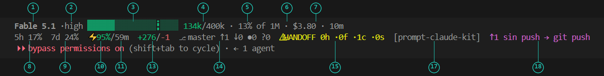
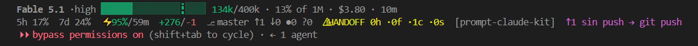
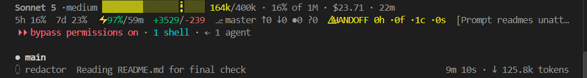
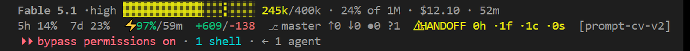
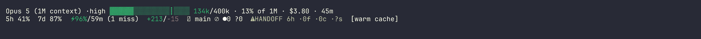

# claude-kit

A personal operating kit for Claude Code: routing, subagents, a review gate, hooks and a status line that keeps `~/.claude` honest across machines.

   

English · [Español](README.es.md)

## What it is

A personal operating kit for Claude Code: routing rules, six subagents, ten skills, five
lifecycle hooks, a status line and the scripts that keep `~/.claude` identical on every
machine. Optimised for Claude Code in VS Code on Windows today; the ideas are tool-agnostic.

## Why

This kit grew out of using Claude Code every day across three very different places: my own
repos, a public-sector data job and consulting contracts. The same problems showed up in all
three. Sessions burned the strongest model on work a small one could do, so I started routing
every task by lane to the cheapest model that can do it. A session that does everything
itself loses the thread, so subagents do the reading and the mechanical writing and only the
summary comes back. A model reviewing its own code approves it, so the review gate insists the
reviewer is never weaker than the author. What actually happened in a session was gone once
the transcript expired, so hooks log it. And I kept discovering too late that context was
huge, the cache was cold or the handoff was stale, so the status line now shows all of that
live in the terminal: context, cache state, plan quota, a cost estimate, git state and whether
`HANDOFF.md` still describes reality. It is built for Claude Code in VS Code today; the ideas
port to Codex CLI and Gemini CLI and that port is on the roadmap. I share it for learning:
every rule points to the paper or the measurement that motivated it, and I expect those
references to change as the evidence does.

## What's inside

`stable` = used daily and covered by tests · `beta` = used, not tested · `experimental` = spec only.

| Piece | Purpose | Maturity |
|---|---|---|
| `home/.claude/statusline.sh` | Two-line status bar | `stable` |
| `home/.claude/rules/thresholds.json` | Every threshold the kit reacts to | `stable` |
| 5 hooks (drift warning, pre-compact draft, failure log, event log, post-compact re-anchor) | Session lifecycle logging and guardrails | `stable` |
| 6 agents (`mecanico`, `operario`, `redactor`, `investigador`, `profundo`, `reviewer`) | Model/effort lanes for delegated work | `stable` — prompts, no test suite; kept stable because they run every day |
| Skills `kickoff`, `spec`, `route`, `handoff`, `xreview`, `manual`, `ahora`, `kit-update` | Session lifecycle | `beta` — used, `/ahora` tested live, no suite |
| Skills `tercerizar`, `visor` | Hand-off to an external agent · session viewer | `beta` |
| `sync-to-home.sh`, `sync-from-home.sh`, `mirror-lib.sh`, `kit-update.sh`, `verify.sh` | The mirror | `stable` — run every session on two machines |
| `harvest.py` | Durable metrics from transcripts | `beta` |
| Bitácora (`docs/bitacora-spec.es.md`) | Project index page | `experimental` — spec only |
| `templates/` | SPEC, TASK, AGENTS, REVIEW contracts | `beta` — used by `/tercerizar` and `/spec` |
| `home/.claude/modules/enjambre/` | Optional: ssh guard + rule for a multi-machine setup, installed only with `--with enjambre` | `beta` — 23 tests, new on 2026-10-15 |
| `home/.claude/MANUAL.md` | The why behind every rule (Spanish) | `stable` — `verify.sh` audits its `Fuente:` lines |

## The status line, explained



**One commit ahead of upstream and the HANDOFF is fresh: the hint says `↑1 sin push → git push`.**


**A Sonnet session at medium effort with a `redactor` subagent running; cache warm at 97%, TTL 59 min.** Unattended runs use bypass with a scoped prompt, a hard stop and reviewer gates — see Roadmap → UNATTENDED. This capture shows that mode, not the default one.


**`⚠HANDOFF 0h ·1f`: one modified file is newer than the handoff, so the handoff no longer describes the tree.**


**The bar rendered from fixtures: warm cache → cooling → cold → near auto-compact → stale HANDOFF.** Regenerate with `docs/tapes/render-states.sh`; its bundled font has no `⎇`/`❄` glyph, so those two show as a box here and as themselves in the real captures above.


*This GIF predates the 2026-10-15 cache redesign: it still shows the old cache segment (hit ratio and TTL), not `⚡ enfriando · 4m`. It is re-recorded on the Mac by `TASK-kit-media.md`.*

New to the bar? Start with the lesson [`docs/leccion-01-lee-tu-barra.en.md`](docs/leccion-01-lee-tu-barra.en.md): the 18 sectors by group, with [a diagram](docs/img/statusline-sectores.en.svg) and a self-check.


Full symbol legend in [`docs/statusline.md`](docs/statusline.md); the design, payload changes,
measured cost and tests in [`docs/statusline-internals.md`](docs/statusline-internals.md).

## Install

Requirements: bash (Git Bash on Windows — that's what this is built and run on), `jq`, `git`.
Python 3 only if you use `harvest.py` or `visor.py`.

```bash
git clone https://github.com/IchiSieben/claude-kit
cd claude-kit
bash sync-to-home.sh   # merges only the portable settings.json keys into ~/.claude,
                        # backs up whatever it replaces, never deletes
bash verify.sh         # checks the mirror landed and runs both test suites
```

Restart Claude Code — `CLAUDE.md`, `settings.json` and skills load at process launch, so
nothing here takes effect mid-session. Update later with `bash kit-update.sh` (pulls, mirrors,
verifies, reminds you to restart).

Nothing under `home/.claude/modules/` is installed by that command; modules go in only with
`--with <name>` (see the next section).

What it does **not** touch: plugins, marketplaces, theme, notifications, `model`, and
`modelSettings` — those are machine-local by design, so a sync never clobbers a per-machine
model or effort override.

The kit ships a `CLAUDE.md` that is the owner's own rules. Fork it — it is meant to be edited
— and it is kept under 70 lines on purpose: that file is re-read every session, so its length
is a context budget, not a style preference.

## If you have more than one machine: enjambre

[enjambre](https://github.com/IchiSieben/enjambre) is the sibling project: it turns your other
machines into worker nodes for anything headless (tests, builds, renders, long `claude -p`
runs). A job is a `TASK-*.md`; enjambre routes it, runs it in a clean worktree on the node and
brings the branch back. What the two share lives in this kit as an optional module:

```bash
bash sync-to-home.sh --with enjambre
```

- **A hook that blocks a raw `ssh <node>`** to one of your nodes outside the enjambre repos, so
  every delegation goes through enjambre's queue and ledger. Nodes come from your own
  `nodes.toml` (or `ENJAMBRE_GUARD_HOSTS`); `ENJAMBRE_RAW_SSH=1` skips it once, logged.
- **The rule** the model reads every session: delegate through enjambre, never by hand.
- **The `enj` block of the status line** (`enj ⬡2/2 ⚙1 ≈$17 hoy`: nodes alive, jobs running,
  today's usage across machines) is already in `statusline.sh` and stays blank without the swarm.

Without the flag nothing is installed. Details: [`home/.claude/modules/enjambre/README.md`](home/.claude/modules/enjambre/README.md).
This repo is itself delegated that way: `AGENTS.md` names the one command a node may run, and the
status-line video below is recorded on the Mac by `TASK-kit-media.md`.

## How I use it in a day

**Kickoff.** Every session starts with [`/kickoff`](docs/routing.md): it reads `HANDOFF.md`,
`SPEC.md`, git state and the last test run, then proposes the next step and which model/effort
to spend on it.

**Spec.** Before touching a multi-file feature I run [`/spec`](docs/routing.md) to interview
myself and write `SPEC.md` — inputs, outputs, invariants, out of scope — so I build against a
contract instead of a vibe.

**Route.** For anything smaller than a full spec, [`/route`](docs/routing.md) recommends the
lane (`mecanico`, `operario`, `redactor`, `investigador`, `profundo`) and execution mode (main
session, subagent, worktree, background) before I spend the first token.

**Which model, from data.** `/route` never names a model from memory. It reads
`home/.claude/rules/models.json` (the facts: ids, context, prices, default effort, regenerated by
`python tools/model-intel.py` from Anthropic's public docs) and `home/.claude/rules/routing.json`
(the judgement: lane → model family + effort + why). To change which model a lane uses, edit
`routing.json` and run `bash tests/route_test.sh`; when the catalogue changes, run `model-intel.py`
and re-check the lanes. Details in [`docs/routing.md`](docs/routing.md).

**Build with subagents.** The main thread decides what and how; the six agents in
[`docs/routing.md`](docs/routing.md) do the reading and the mechanical writing, and only their
summary comes back to the session that's paying for context.

**Review gate.** [`/xreview`](docs/reviewer.md) packs the diff, spec and rubric for a
cross-model review, or spawns the `reviewer` agent — never the same model that wrote the code,
because reviewer ≥ author is the rule, and switching the session model mid-task just kills the
prompt cache.

**Handoff.** Before compacting or closing, [`/handoff`](docs/handoff.md) writes `HANDOFF.md`:
goal, state, decisions, what failed, next steps — so the next session (mine or a fresh one)
doesn't re-explore what this one already found. See [`docs/context.md`](docs/context.md) for
the token bands that trigger this and [`docs/thresholds.md`](docs/thresholds.md) for every
number behind the status line's hints. [`docs/hooks.md`](docs/hooks.md) and
[`docs/manual-and-now.md`](docs/manual-and-now.md) cover the logging underneath and the
`/manual` and `/ahora` commands that surface it.

## References

The rules that cite evidence are checked against the real papers in
[`docs/references.md`](docs/references.md); citations that could not be resolved are listed
there as unverified rather than dressed up. The reviewer gate ("reviewer never weaker than the
author") is grounded in Panickssery et al., "LLM Evaluators Recognize and Favor Their Own
Generations," NeurIPS 2024 ([arXiv:2404.13076](https://arxiv.org/abs/2404.13076)); the
candidates found for citations that could not be verified are tracked in
[`docs/references-candidates.md`](docs/references-candidates.md). References are expected to
change as the evidence does — propose or challenge one with
[`.github/ISSUE_TEMPLATE/reference.md`](.github/ISSUE_TEMPLATE/reference.md).

## Roadmap

- Status line: decide the render budget (416 ms measured vs 200 ms target; re-measured on
  2026-10-15 under load, no change attributable to the cache redesign — a quiet-machine run is
  pending). `permission_mode` indicator restored if the payload brings it back.
- Alerts: none yet beyond the bar's hint line and the red-drift `SessionStart` warning.
- `/ahora` hybrid — live git + drift instead of a snapshot only.
- Bitácora v2, a weekly report — spec only for now.
- `/tercerizar` v2; the schema for a project registry could ship even though the registry
  itself stays private.
- Ports: Codex CLI, Gemini CLI — not started.
- Parallel orchestration — owner's reference "JEP": `[owner: specify]`.
- A written spending budget does not exist yet — the thresholds track quota, not money.
- The manual's format, and the way it is produced and read, is a known gap: it is a first
  version. Readability and the production pipeline are to be improved.
- An interactive or video demo of the bar reacting live — cache cooling, compaction, handoff.
  In progress: a terminal recording from fixtures (`docs/tapes/media.sh`, run on the Mac).
- An `UNATTENDED:` pre-approval line, so a session can accept an owner-approved unattended
  scope without stopping to ask.

## Licence

[Apache-2.0](LICENSE).

## Author

Yoichi Palacios Tanaka (IchiSieben) · [ichisieben.dev](https://ichisieben.dev)

Data engineer / developer, Lima, Peru — GitHub [IchiSieben](https://github.com/IchiSieben). See
[`CITATION.cff`](CITATION.cff) if you build on this.
